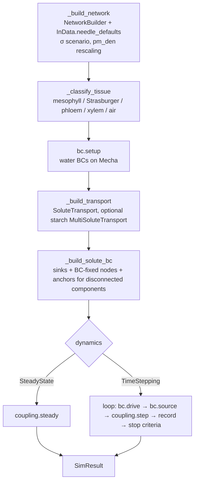

# Needle water–sucrose simulations

Module: [simulations/needle.py](../simulations/needle.py)
Post-processing: [simulations/post_sim.py](../simulations/post_sim.py)

`needle.py` runs coupled water + sucrose transport on a conifer-needle
cross-section. The anatomy comes from GRANAP (`NeedleAnatomy`), the hydraulics from
MECHA (`Mecha`), solute transport from `SoluteTransport` /
`MultiSoluteTransport`, and the osmotic coupling from the
[coupled solver](CoupledSolver.md).

The module does not do any plotting. It builds a simulation from a declarative
description, runs it, and returns a plain, picklable result. Figures and
animations are made from that result by `post_sim.py`.

---

## 1. Design

### 1.1 Composition of immutable options

A run is described by one `Experiment`. It is made of independent, frozen
dataclasses, one for each modelling choice:

```text
Experiment
├── anatomy   : Anatomy                         geometry draw + MECHA indices
├── solute    : Solute                          sucrose transport properties
├── bc        : DirichletBC | NeumannBC         water + sucrose boundary conditions
│               └── diurnal : None | Diurnal    optional day/night modulation
├── dynamics  : SteadyState | TimeStepping      steady solve or θ-method march
├── coupling  : NoCoupling | Picard | JFNK      water ↔ solute osmotic coupling
├── starch    : None | Starch | DielStarch      optional immobile second species
├── t_kelvin                                    temperature (van't Hoff)
└── edge_snapshot_dt                            per-link snapshot interval
```

Design consequences:

- **Orthogonality.** Each axis can be changed on its own. A variant is one call:
  `exp.replace(coupling=Picard())`.
- **Immutability.** Options are `frozen=True`, so you can share them, hash them and
  send them to worker processes safely.
- **Reproducibility.** `Experiment.describe()` turns the whole option tree,
  including each option's type name, into a nested JSON-friendly dict. This dict is
  stored in `SimResult.params` and written next to each saved result.
- **Validation at construction.** `Experiment.__post_init__` rejects starch without
  `TimeStepping` and sink groups that are not in `SINK_GROUPS`.

### 1.2 Strategy objects (polymorphic hooks)

The option classes are more than parameter containers. They hold the behaviour
for their axis, and `NeedleSimulation` calls them through a small set of hooks.

| Option | Hooks called by the engine |
|---|---|
| `BoundaryConditions` (base of `DirichletBC`, `NeumannBC`) | `setup(sim)`, `drive(sim, t)`, `source(sim, c, t)`, `steady_rhs(sim)`, `fixed_concentrations(sim)`, `target_flow(sim, t)`, `f(t)`, `g(t)` |
| `NoCoupling`, `Picard`, `JFNK` | `step(sim, c, baseline, rhs, transport_step)`, `steady(sim, rhs)` |
| `Starch`, `DielStarch` | `rates(t) -> (k_syn, k_deg)` |

To add a boundary condition, a coupling scheme or a reaction law, subclass or
duck-type the matching option. The engine does not need to change.

### 1.3 Geometry caching

Drawing a `NeedleAnatomy` is expensive and stochastic, but it is deterministic
for a fixed seed. `GeometryBase` wraps one draw, and `get_geometry_base(seed)`
caches it **per process**. Parallel workers rebuild the anatomy from the seed
instead of pickling the live network. Every run still builds its own private
`Mecha` scaffold, so runs never share mutable solver state.

### 1.4 Engine: `NeedleSimulation`

`NeedleSimulation(exp).run()` goes through these steps:



Points to note:

- **Tissue classification.** Cells are grouped by `cgroup` and `cell_type`.
  Mesophyll is cgroup 4, Strasburger cells are cgroup 12, phloem is cgroup 11 and
  xylem is cgroup 13. Air spaces are found with `is_wall_air_cell`.
  `phloem_loading` means the Strasburger cells, or the phloem if there are no
  Strasburger cells.
- **Sucrose Dirichlet set.** This set contains the sink cells at `c_sink`, any
  values from `bc.fixed_concentrations`, and isolated nodes. It also anchors one
  node in every connected component that has no sink or mesophyll node, so the
  linear system is never singular.
- **Osmotic baseline.** In transient runs, a sucrose-free `water_flux` is solved
  first. It gives the background $\Psi_{os}$ and the reference transpiration
  `j_w[0]`. The sucrose van't Hoff term $-RTc$ is then added on top of that
  baseline.
- **Starch.** Starch is an immobile second species (all diffusivities are 0). It
  is solved together with sucrose as one block via
  `MultiSoluteTransport.solve_coupled`. The reaction matrix is rebuilt at every
  step from `starch.rates(t)`:

  $$K(t) = \begin{pmatrix} -k_f & k_r \\ k_f & -k_r \end{pmatrix}$$

### 1.5 Result: `SimResult`

`SimResult` contains only arrays and scalars: no live MECHA objects. Frames are
stored as `float32`.

| Field | Steady | Dynamic | Meaning |
|---|:-:|:-:|---|
| `concentration` | `(N,)` | `(n_steps+1, N)` | sucrose on all nodes [mol/cm³] |
| `concentration_starch` | – | `(n_steps+1, N)` | starch (if enabled) |
| `times`, `interior_mass`, `frac_to_sink` | – | ✓ | time [d], stored mass, cumulative outflow at all Dirichlet nodes [mol] |
| `stop_reason` | – | ✓ | which stop criterion ended the run |
| `q_load`, `n_iterations`, `converged` | ✓ | – | sink uptake [mol/d] and coupling status |
| `water_flux_total` | ✓ | ✓ | transpiration through `wall_air` walls [cm³/d] |
| `cell_polygons`, `cell_ids`, `node_of_cell` | ✓ | ✓ | geometry for offline maps |
| `extras` | ✓ | ✓ | series-specific arrays (see below) |

Main `extras` keys (dynamic runs):

- Fluxes: `j_s` (total to sinks), `j_<group>` (one per sink group), `j_w`, and
  `j_w_target` (Neumann only) [mol/d, cm³/d].
- Budget: `q_prod`, `cum_prod`, `cum_export`, `cum_out`, `ratio_inst`,
  `ratio_cum`, `mass_balance`. `mass_balance` is the closure error, which should be
  zero up to solver round-off.
- Drivers: `f_drive`, `g_drive`, `c_xylem`.
- Coupling: `n_couple`, `couple_ok`.
- Starch: `m_starch`, `k_f`, `k_r`.
- Per-link snapshots: `edge_segments`, `edge_path` (an index into `EDGE_PATHS`),
  `edge_t`, `edge_solute`, `edge_water`, `edge_peclet`.
- Tissue maps: `tissue_meso`, `tissue_strasburger`, `tissue_phloem`,
  `tissue_xylem`, `tissue_airspace`.

Steady runs store `j_<group>`, the edge snapshots, the tissue maps and the
steady-state diagnostics below.

#### Steady-state diagnostics

After a `SteadyState` solve, `_steady_metrics` computes the transport quantifiers
listed in `STEADY_METRICS` and stores them as scalar arrays in `extras`. They are
also printed in verbose mode and included in `res.summary()`. At steady state the
sink uptake $q$ (= `q_load`) equals the production.

Notation: $\bar c_{meso}$ is the volume-weighted mean mesophyll concentration,
$M$ is the stored sucrose mass on interior nodes, and $J_e$, $Pe_e$ are the
per-link solute flux and Péclet number of the steady snapshot.

| Key | Unit | Definition | Meaning |
|---|---|---|---|
| `loading_resistance` | d/cm³ | $(\bar c_{meso} - c_{sink}) / q$ | concentration drop from mesophyll to sinks per unit export; lower means easier loading |
| `max_assimilation` | µmol m⁻² s⁻¹ | $A \,(c_{max} - c_{sink}) / (\bar c_{meso} - c_{sink})$ | assimilation at which $\bar c_{meso}$ would reach `Solute.c_max`. `NeumannBC` only (NaN otherwise). Linear in $A$ at fixed $E$, exact without osmotic coupling |
| `turnover` | d | $M / q$ | mean residence time of sucrose in the needle |
| `load_fraction` | – | PD uptake / total uptake | symplastic share of the net flux entering sink nodes (links crossing from non-sink to sink nodes) |
| `mean_peclet` | – | $\sum \lvert J_e\rvert\,\lvert Pe_e\rvert\,\operatorname{sgn}(J_e Pe_e) / \sum \lvert J_e\rvert$ | flux-weighted signed Péclet number. $> 0$: solute moves with the water; $< 0$: against it |
| `c_meso_mean` | mol/cm³ | $\bar c_{meso}$ | mean mesophyll concentration (stored, not in `STEADY_METRICS`) |

All ratios return NaN when the denominator is zero (no export, no uptake or
$\bar c_{meso} \le c_{sink}$).

```python
res = NeedleSimulation(exp.replace(dynamics=SteadyState())).run()
res.summary()['loading_resistance'], float(res.extras['turnover'])
```

Persistence and inspection:

- `res.save(path.npz)` writes a compressed `.npz` file and a `*.params.json`
  sidecar. `SimResult.load(path)` reads them back.
- `res.summary()` returns a flat dict for tables.
- `res.param(name)` finds a value by name anywhere in the nested `params` tree.

### 1.6 Parallel driver

`run_experiments(experiments, max_workers=None)` runs a list of experiments in a
`ProcessPoolExecutor`. Each worker is pinned to one BLAS thread to avoid
oversubscription. With one job or one worker, the experiments run inline.
Results come back in input order.

---

## 2. Option reference

Units: lengths in µm/cm, volumes in cm³, concentrations in mol/cm³ (1 mol/cm³ = 10³ M), rates in mol/d, time in d, potentials in hPa.

### `Anatomy`
| Field | Default | Meaning |
|---|---|---|
| `seed` | `42` | Anatomy draw (`None` → random) |
| `pm_den` | `None` | Base PD frequency (Fplxheight). Rescales the per-interface map by `pm_den / 8.0e5`, which affects both the PD hydraulic K and the solute DF |
| `h_idx`, `i_mat`, `i_sce` | `0, 0, 1` | MECHA hydraulic / maturity / scenario indices |

### `Solute`
| Field | Default | Meaning |
|---|---|---|
| `d_pd` | `D_PD_SUCROSE` (0.1 × free) | PD diffusivity [cm²/d] |
| `d_apo` | `D_APO_SUCROSE` (0.8 × free) | wall diffusivity [cm²/d] |
| `d_mem` | `1e-6` | passive membrane diffusivity [cm²/d] |
| `sigma` | `0.97` | membrane reflection coefficient |
| `sigma_xylem` | `None` | effective xylem reflection for the solute (1 → impermeable) |
| `ops` | `'T'` | `'D'` diffusion only, `'T'` advection + diffusion |
| `scheme` | `'sg'` | `'upwind'` or `'sg'` (Scharfetter–Gummel) |
| `c_max` | `3.0e-4` (0.3 M) | mesophyll concentration ceiling used by the `max_assimilation` diagnostic [mol/cm³] |

`DIFF_SUCROSE` = 5.2e-6 cm²/s × 86400 ≈ 0.449 cm²/d is the free-solution value.

### Boundary conditions

The shared fields (`BoundaryConditions`) are:

- `psi_xyl` (−200 hPa): Dirichlet xylem water potential.
- `sinks`: a tuple of groups from `SINK_GROUPS = ('strasburger', 'phloem', 'phloem_loading', 'xylem')`.
- `c_sink` (0): sink concentration.
- `diurnal`: `None` or a `Diurnal`.

**`DirichletBC`** (prescribed potentials and concentrations)

| Field | Default | Meaning |
|---|---|---|
| `air` | `'psi'` | `'psi'` → use `psi_air`; `'rh'` → Kelvin potential of `rh_air` |
| `psi_air`, `rh_air` | `-1e4`, `0.99` | air-space water potential, multiplied by $f(t)$ |
| `c_meso` | `None` | holds the mesophyll at a fixed concentration |
| `c_photo` | `0` | mesophyll increment per step at $g = 1$ [mol/cm³] |

**`NeumannBC`** (prescribed gas exchange)

| Field | Default | Meaning |
|---|---|---|
| `transpiration_E` | `1.0` mmol m⁻² s⁻¹ | outflow through the air spaces, multiplied by $f(t)$ and split by area |
| `assimilation_A` | `5.0` µmol m⁻² s⁻¹ | converted to sucrose (12 C, upper bound), multiplied by $g(t)$ and spread by mesophyll volume |
| `ref_area` | `None` | reference area [m²]. `None` → outer perimeter × slice height |

The conversions use `transpiration_to_flow(E, area)` and
`assimilation_to_sucrose(A, area)`.

**`Diurnal`** (`period`, `f_phase`, `g_phase`, `f_baseline`)

$$f(t) = b + (1-b)\,\tfrac12\bigl(1-\cos(2\pi t/P + \phi_f)\bigr) \in [b, 1], \qquad
g(t) = \max\bigl(0, -\cos(2\pi t/P + \phi_g)\bigr) \in [0, 1]$$

Here $t = 0$ is midnight. Both functions peak at noon. Without `diurnal`, $f = g = 1$.

### Dynamics

- **`SteadyState(continuation=None)`**: direct coupled steady solve.
  `continuation` is an optional homotopy λ schedule, used by Picard and JFNK only.
- **`TimeStepping`**: θ-method march.

| Field | Default | Meaning |
|---|---|---|
| `dt`, `max_steps` | `1/24`, `48` | step size [d] and step cap |
| `theta` | `1.0` | 1 = implicit Euler, 0.5 = Crank–Nicolson |
| `c0_meso` | `0` | initial free mesophyll sucrose (impulse) |
| `sink_fraction` | `None` | stop when cumulative outflow ≥ fraction × initial mass |
| `equil_tol` | `None` | stop when max\|Δc\| < tol |
| `balance_tol`, `balance_window` | `None`, `0` | stop when \|⟨export/production⟩ − 1\| < tol over the window [d] |

### Coupling

| Option | Behaviour |
|---|---|
| `NoCoupling()` | One pass per step. $\Psi_{os}$ is lagged from the start-of-step concentration. In steady mode: one water solve, then one transport solve |
| `Picard(tol=10, max_iter=12, relax=1.0)` | Fixed-point iteration, optionally under-relaxed. `tol` is in hPa |
| `JFNK(tol=10, max_iter=10, inner=30, line_search='armijo', rdiff=1e-3)` | Jacobian-free Newton–Krylov on the cell concentrations |

### Starch

- **`Starch(k_syn=2, k_deg=1, c0=0)`**: constant rates [1/d].
- **`DielStarch(k_f_day=6, k_r_night=6, period=1, phase=0, c0=0)`**: uses
  $s(t) = -\cos(2\pi t/P + \phi)$ with $k_f = k_{f,day}\max(0, s)$ and
  $k_r = k_{r,night}\max(0, -s)$. Starch is synthesised by day and remobilised at
  night.

---

## 3. Usage

### 3.1 Requirements and import

`needle.py` adds `../../MECHA-dev/src` and `../../GRANAP-dev/src` to
`sys.path`, so a GRANAP checkout must sit next to `MECHA-dev`. Run scripts from
`simulations/`, or put that folder on `sys.path`:

```python
import sys; sys.path.insert(0, 'simulations')
from needle import Experiment, NeedleSimulation, run_experiments
```

Outputs are written by default to `simulations/outputs/` (`needle._OUT_DIR`).

### 3.2 Minimal run

```python
from needle import Anatomy, DirichletBC, Experiment, JFNK, NeedleSimulation, TimeStepping

exp = Experiment(
    label='impulse',
    anatomy=Anatomy(seed=42),
    bc=DirichletBC(psi_xyl=-200.0, air='psi', psi_air=-1.0e4),
    dynamics=TimeStepping(dt=0.1, max_steps=40, c0_meso=50.0e-6, sink_fraction=0.9),
    coupling=JFNK(),
)
res = NeedleSimulation(exp).run()
print(res.summary())
res.save('simulations/outputs/needle_impulse.npz')
```

This is the module's own `__main__` demo. It runs the experiment above at two PD
diffusivities in parallel and writes a mass-balance plot and a concentration GIF
for each.

### 3.3 Variants and sweeps

```python
fast = exp.replace(label='impulse_picard', coupling=Picard(relax=0.7))
grid = [exp.replace(label=f'dpd{d:.1e}', solute=Solute(d_pd=d)) for d in (0.01, 0.1, 0.5)]
results = run_experiments(grid)             # one process per experiment, order preserved
```

Nested options are changed with `dataclasses.replace`:

```python
from dataclasses import replace
longer = exp.replace(dynamics=replace(exp.dynamics, max_steps=200))
```

### 3.4 Reloading and plotting

```python
from needle import SimResult
from post_sim import mass_balance_plot, concentration_gif, flow_network_gif

res = SimResult.load('simulations/outputs/needle_impulse.npz')
mass_balance_plot(res, 'mb.png')
concentration_gif(res, 'sucrose.gif', max_frames=60, fps=8)
res.plot_flow_network('sucrose_flow.pdf', quantity='solute', tol_decades=2.0)  # 'water' | 'peclet'
flow_network_gif(res, 'water_flow.gif', quantity='water')
```

Other helpers in `post_sim.py` are `anatomy_plot`, `diurnal_flux_plot`,
`diel_starch_plot`, `starch_comparison_plot`, `starch_concentration_gif`,
`budget_plot` and `load_results`.

---

## 4. Examples from `simulations/`

Each script defines a module-level `EXPERIMENT` (or `GRID` / `params_grid`). Other
scripts can import it and derive new experiments from it with `.replace(...)`.

| Script | BC | Dynamics | Coupling | Starch | Purpose |
|---|---|---|---|---|---|
| [diurnal.py](../simulations/diurnal.py) | Dirichlet + `Diurnal` | 48 × 1 h | JFNK | – | day/night water and sucrose fluxes |
| [diurnal_starch.py](../simulations/diurnal_starch.py) | as `diurnal` | 72 × 1 h | JFNK | `Starch` sweep | effect of constant $k_{syn}$, $k_{deg}$ |
| [diurnal_starch_diel.py](../simulations/diurnal_starch_diel.py) | as `diurnal` | 30 d × 1 h | JFNK | `DielStarch` | limit-cycle starch dynamics |
| [flux_budget.py](../simulations/flux_budget.py) | Neumann (E, A) | march to export = production | Picard | – | phloem-loading budget, xylem open |
| [flux_budget_steady.py](../simulations/flux_budget_steady.py) | Neumann (E, A) | `SteadyState` | JFNK | – | same budget solved directly |
| [flux_cdiff.py](../simulations/flux_cdiff.py) | Dirichlet, ψ_air sweep | 200 × 0.1 d | JFNK | – | 10 × 10 grid of `d_pd` × transpiration |
| [flux_pdens.py](../simulations/flux_pdens.py) | Dirichlet, ψ_air sweep | 200 × 0.1 d | JFNK | – | 10 × 10 grid of `pm_den` × transpiration |

### 4.1 Diurnal cycle, Dirichlet drivers ([diurnal.py](../simulations/diurnal.py))

The air potential follows $-10^3 f(t)$ hPa. Each hour, $5\,\mu\text{M} \cdot g(t)$ of
sucrose is injected into the mesophyll.

```python
EXPERIMENT = Experiment(
    label='diurnal',
    anatomy=Anatomy(seed=42),
    solute=Solute(d_pd=D_PD_SUCROSE),
    bc=DirichletBC(
        psi_xyl=-200.0, air='psi', psi_air=-1.0e3, c_photo=5.0e-6,
        sinks=('phloem_loading', 'xylem'),
        diurnal=Diurnal(period=1.0, f_baseline=0.1),
    ),
    dynamics=TimeStepping(dt=1.0 / 24.0, max_steps=48),
    coupling=JFNK(),
)
res = NeedleSimulation(EXPERIMENT, verbose=True).run()
diurnal_flux_plot(res, stem + '_fluxes.png')      # j_w, j_s, j_s/j_w vs f, g
```

### 4.2 Starch sweep built from another script ([diurnal_starch.py](../simulations/diurnal_starch.py))

This script reuses `diurnal.EXPERIMENT` and adds only the starch option. The
`(0, 0)` entry is the starch-free reference.

```python
from diurnal import EXPERIMENT as DIURNAL

BASE = DIURNAL.replace(dynamics=replace(DIURNAL.dynamics, max_steps=72))
GRID = [
    BASE.replace(label=label(kf, kr),
                 starch=Starch(k_syn=kf, k_deg=kr) if (kf or kr) else None)
    for kf, kr in [(0, 0), (1, .5), (2, .5), (2, 2), (5, .5), (2, 5)]
]
results = run_experiments(GRID)
starch_comparison_plot(results, stem + '_comparison.png')
```

### 4.3 Diel starch and limit-cycle check ([diurnal_starch_diel.py](../simulations/diurnal_starch_diel.py))

```python
EXPERIMENT = Experiment(
    label='diurnal_starch_diel',
    ...,                                            # same BC/solute as diurnal.py
    dynamics=TimeStepping(dt=1/24, max_steps=30 * 24),
    coupling=JFNK(),
    starch=DielStarch(k_f_day=6.0, k_r_night=6.0, period=1.0),
)
(res,) = run_experiments([EXPERIMENT], max_workers=1)
m = res.m_starch                                    # mean cell starch per step
spd = 24
drift = abs(m[-spd:].max() - m[-2*spd:-spd].max()) / m[-2*spd:-spd].max()
```

If the daily starch peak drifts by less than 2 % from one day to the next, the
system is treated as being in a periodic steady state.

### 4.4 Flux budget with Neumann BCs ([flux_budget.py](../simulations/flux_budget.py))

The needle starts with no sucrose. Constant E and A are applied, and the march
runs until export into the Strasburger and sieve cells balances production over a
2-day window. Here the xylem is solute-permeable (`sigma_xylem=0`) but is not a
sink.

```python
EXPERIMENT = Experiment(
    label='flux_budget_xyopen',
    anatomy=Anatomy(seed=42),
    solute=Solute(d_pd=D_PD_SUCROSE, d_apo=D_APO_SUCROSE, sigma_xylem=0.0),
    bc=NeumannBC(psi_xyl=-200.0, transpiration_E=1.7, assimilation_A=3.6,
                 sinks=('strasburger', 'phloem')),
    dynamics=TimeStepping(dt=2/24, max_steps=24 * 20,
                          balance_tol=1e-3, balance_window=2.0),
    coupling=Picard(max_iter=20),
)
e = res.extras
e['ratio_inst'][-1], e['ratio_cum'][-1]             # export / production
np.max(np.abs(e['mass_balance']))                   # closure check
budget_plot(res, stem + '_budget.pdf')
```

The script has a `RUN_SIMULATION` switch. Set it to `False` to re-plot from the
stored `.npz` without running the march again.

[flux_budget_steady.py](../simulations/flux_budget_steady.py) uses the same
set-up but with `dynamics=SteadyState()`, `sigma_xylem=1.0` and `JFNK()`. The
result is then a single field, with `q_load`, `j_<group>` and the
[steady-state diagnostics](#steady-state-diagnostics) in place of time series.

### 4.5 Parameter sweeps ([flux_cdiff.py](../simulations/flux_cdiff.py), [flux_pdens.py](../simulations/flux_pdens.py))

These scripts build a 10 × 10 grid from one `BASE` and run all 100 experiments in
parallel. The x-axis is the transpiration $Q_{tot}$ = `res.water_flux_total`. It is
set indirectly by sweeping $|\psi_{air}| \in [500, 30\,000]$ hPa. The metric is
`res.frac_to_sink[-1]`, the cumulative mass to the sinks.

```python
BASE = Experiment(anatomy=Anatomy(seed=42),
                  dynamics=TimeStepping(dt=0.1, max_steps=200, c0_meso=50e-6),
                  coupling=JFNK())
params_grid = [
    BASE.replace(label=f'dpd{d_pd:.2e}_psiair{abs(p):.0f}',
                 solute=Solute(d_pd=d_pd),
                 bc=DirichletBC(psi_xyl=-200.0, air='psi', psi_air=p,
                                sinks=('phloem_loading', 'xylem')))
    for d_pd in D_PD_VALUES for p in PSI_AIR_VALUES
]
results = run_experiments(params_grid, max_workers=None)
mass = np.array([r.frac_to_sink[-1] * 1e12 for r in results]).reshape(N, N)
```

`flux_pdens.py` follows the same pattern. It sweeps
`Anatomy(seed=42, pm_den=...)` over $[8\times10^3, 8\times10^7]$ at a fixed
`d_pd = 0.75 · DIFF_SUCROSE`. Because `pm_den` also scales the PD hydraulic
conductance, $Q_{tot}$ is read back per experiment rather than per column.

---
